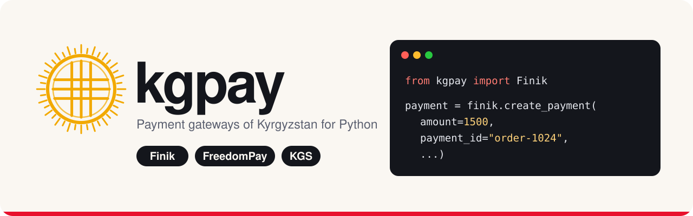

<p align="center">
  <picture>
    <source media="(prefers-color-scheme: dark)" srcset="https://raw.githubusercontent.com/Akjol06/kgpay/main/.github/assets/banner-dark.svg">
    
  </picture>
</p>

<p align="center">
  <a href="https://pypi.org/project/kgpay/"></a>
  <a href="https://pypi.org/project/kgpay/"></a>
  <a href="https://github.com/Akjol06/kgpay/actions/workflows/tests.yml"></a>
  <a href="LICENSE"></a>
</p>

<p align="center">
  <b>English</b> · <a href="https://github.com/Akjol06/kgpay/blob/main/README.ru.md">Русский</a>
</p>

<p align="center">
  Accept payments in Kyrgyzstan in a few lines of Python.<br>
  Correctly signed requests, verified webhooks, and the security pitfalls already handled.
</p>

---

## Providers

| Provider | Methods | Sync | Async | Status |
|---|---|:-:|:-:|---|
| **[Finik](https://www.finik.kg)** | QR, bank cards | `Finik` | `AsyncFinik` | ✅ Stable |
| **[FreedomPay](https://freedompay.kg)** | Cards, wallets, QR | `FreedomPay` | `AsyncFreedomPay` | ✅ Stable |
| Mbank · O!Dengi · Elsom | — | — | — | 🔜 [Help wanted](#contributing) |

## Install

```bash
pip install kgpay
```

Requires Python 3.10+. Dependencies: `httpx` and `cryptography`, nothing else.

## How it works

`kgpay` is **only code**: there are no accounts, no money and no shared keys inside it.

```
 your app ──▶ kgpay ──▶ Finik / FreedomPay API ──▶ money lands on YOUR merchant account
                ▲
        your own keys (.env)
```

1. You sign a contract with the provider and get your keys from their merchant dashboard.
2. You keep them in your own `.env` and pass them to the client.
3. The customer pays the provider directly. `kgpay` signs the requests and verifies the answers.

## Quick start: Finik

```python
import os
from kgpay import Finik

finik = Finik(
    api_key=os.environ["FINIK_API_KEY"],
    account_id=os.environ["FINIK_ACCOUNT_ID"],
    private_key=os.environ["FINIK_PRIVATE_KEY"],  # PEM; one line with \n works too
    sandbox=True,                                 # test environment, no real money
    merchant_name="My Shop",                      # shown on the payment page
)

payment = finik.create_payment(
    amount=1500,                                  # whole som
    payment_id="order-1024",                      # your unique id, comes back in the webhook
    description="Order #1024",
    redirect_url="https://shop.kg/thanks",
    webhook_url="https://shop.kg/api/webhooks/finik",
)

print(payment.url)  # send the customer here
```

### Receiving the webhook

```python
from fastapi import FastAPI, HTTPException, Request
from kgpay import AsyncFinik, ForeignAccountError, InvalidSignatureError

app = FastAPI()
finik = AsyncFinik(...)

@app.post("/api/webhooks/finik")
async def finik_webhook(request: Request):
    try:
        event = finik.parse_webhook(
            body=await request.body(),
            headers=request.headers,
            path="/api/webhooks/finik",  # the PUBLIC path Finik calls
        )
    except InvalidSignatureError:
        raise HTTPException(401)
    except ForeignAccountError:
        return {"ok": True}              # signed by Finik, but paid to someone else

    order = await get_order(event.payment_id)
    if event.succeeded and order and not order.paid and event.amount_covers(order.total):
        await mark_paid(order)           # idempotent: Finik retries webhooks
    return {"ok": True}
```

Full runnable example: [`examples/fastapi_app.py`](https://github.com/Akjol06/kgpay/blob/main/examples/fastapi_app.py).

## Quick start: FreedomPay

```python
from kgpay import FreedomPay

fp = FreedomPay(
    merchant_id=os.environ["FREEDOMPAY_MERCHANT_ID"],
    secret_key=os.environ["FREEDOMPAY_SECRET_KEY"],
    testing=True,                                 # pg_testing_mode=1
)

payment = fp.create_payment(
    amount="1500.50",                             # up to 2 decimals
    payment_id="order-1024",
    description="Order #1024",
    redirect_url="https://shop.kg/thanks",
    failure_url="https://shop.kg/failed",         # optional
    webhook_url="https://shop.kg/api/webhooks/freedompay",
)
```

FreedomPay expects a **signed XML reply** from your result URL. `kgpay` builds it:

```python
from fastapi import Response

PATH = "/api/webhooks/freedompay"

@app.post(PATH)
async def freedompay_webhook(request: Request):
    try:
        event = fp.parse_webhook(body=await request.body(), path=PATH)
    except InvalidSignatureError:
        raise HTTPException(401)

    if event.succeeded and event.amount_covers(order_total(event.payment_id)):
        await mark_paid(event.payment_id)

    xml = fp.webhook_response(path=PATH, status="ok")
    return Response(xml, media_type="application/xml")
```

## Pitfalls kgpay handles for you

| | Pitfall | What kgpay does |
|---|---|---|
| 🔐 | **Signatures.** Finik uses RSA-SHA256 over a canonical string; FreedomPay uses PayBox MD5 with a script name. | Tested byte-for-byte against Finik's official library and a real production webhook from Finik's docs. |
| 🕵️ | **Paid to someone else.** Finik signs webhooks for *all* merchants with one key, so a valid signature does not mean the money is yours. | `parse_webhook` checks `accountId` and raises `ForeignAccountError`. |
| 🧪 | **Test payments on a live site.** | A live FreedomPay client rejects callbacks with `pg_testing_mode=1`. |
| 💰 | **Underpayment.** | `event.amount_covers(total)`; a missing amount never covers anything. |
| 🔢 | **Silent rounding.** Finik takes whole som. | Fractions or `float` raise immediately instead of rounding money. |
| 🔀 | **Paths behind a proxy.** The provider signs the URL it called, e.g. `/api/...`, even if nginx strips `/api`. | You pass the public `path` explicitly. |
| 🔁 | **Retries.** Providers resend webhooks for hours or days. | Documented: make crediting idempotent by `payment_id`. |

## API at a glance

```python
payment.url                  # where to send the customer
payment.payment_id           # your id
payment.provider_payment_id  # provider's id (FreedomPay)

event.status                 # PaymentStatus.SUCCEEDED | FAILED | PENDING | UNKNOWN
event.succeeded              # bool
event.payment_id             # your id from create_payment
event.transaction_id         # provider's transaction id
event.amount                 # Decimal | None
event.amount_covers(total)   # paid at least `total`?
event.raw                    # the full original payload
```

| Exception | When |
|---|---|
| `APIError` | The provider returned an error or is unreachable (`.status_code`, `.response_text`) |
| `InvalidSignatureError` | Missing or wrong webhook signature, or a test payment on a live client |
| `ForeignAccountError` | Finik webhook for another merchant's `account_id` |
| `InvalidPayloadError` | The webhook body cannot be parsed |

All of them inherit from `KGPayError`.

## Contributing

New providers are very welcome, especially **Mbank, O!Dengi and Elsom**. Their APIs are not publicly documented, so if you have access to the docs as a merchant, a PR adding the client and tests is the most valuable contribution.

```bash
git clone https://github.com/Akjol06/kgpay && cd kgpay
uv sync
uv run pytest
uv run ruff check .
```

Each provider is one module in `src/kgpay/` with a sync and an async client, `create_payment` and `parse_webhook`, plus tests that verify signatures against the provider's own reference data.

## License

[MIT](LICENSE). `kgpay` is an independent project and is not affiliated with Finik, AversPay or FreedomPay.
