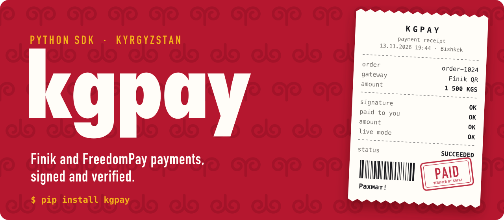
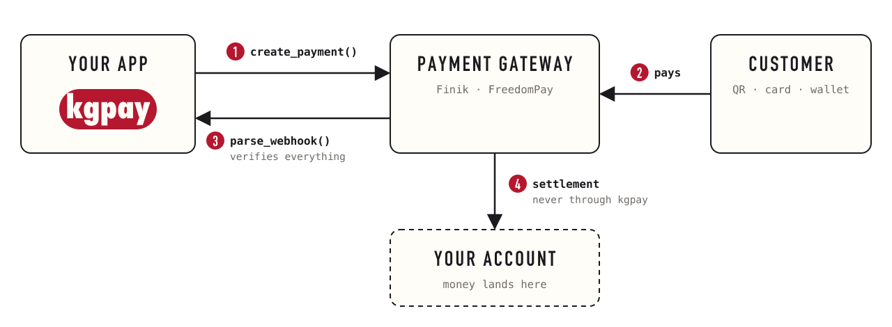

<p align="center">
  
</p>

<p align="center">
  <a href="https://pypi.org/project/kgpay/"></a>
  <a href="https://pypi.org/project/kgpay/"></a>
  <a href="https://github.com/Akjol06/kgpay/actions/workflows/tests.yml"></a>
  <a href="https://github.com/Akjol06/kgpay/blob/main/LICENSE"></a>
</p>

<p align="center">
  <b>English</b> &nbsp;·&nbsp; <a href="https://github.com/Akjol06/kgpay/blob/main/README.ru.md">Русский</a>
</p>

<br>

Accept payments in Kyrgyzstan from Python. `kgpay` signs every request the way the gateway expects, verifies every webhook, and refuses the payments that only *look* paid.

```bash
pip install kgpay
```

```python
from kgpay import Finik

finik = Finik(api_key=..., account_id=..., private_key=..., sandbox=True)

payment = finik.create_payment(
    amount=1500,
    payment_id="order-1024",
    description="Order #1024",
    redirect_url="https://shop.kg/thanks",
    webhook_url="https://shop.kg/api/webhooks/finik",
)
# → send the customer to payment.url
```

## Where the money goes

<p align="center">
  <picture>
    <source media="(prefers-color-scheme: dark)" srcset="https://raw.githubusercontent.com/Akjol06/kgpay/main/.github/assets/flow-en-dark.svg">
    
  </picture>
</p>

`kgpay` is only code. There are no accounts, no money and no shared keys inside it. You sign a contract with the gateway, keep your own keys in `.env`, and the customer's money settles straight to your merchant account.

## Gateways

| | Gateway | Payment methods | Clients | |
|:-:|---|---|---|---|
| 🟥 | **[Finik](https://www.finik.kg)** | QR, bank cards | `Finik` · `AsyncFinik` | **ready** |
| 🟨 | **[FreedomPay](https://freedompay.kg)** | Cards, wallets, QR | `FreedomPay` · `AsyncFreedomPay` | **ready** |
| ⬜ | Mbank · Bakai Bank · Optima Bank · Eldik Bank · O!Dengi | | | [help wanted](#contributing) |

Every client has the same two methods: `create_payment()` and `parse_webhook()`. Sync clients suit Django, Flask and scripts; async ones suit FastAPI.

## Finik

```python
import os
from kgpay import AsyncFinik, ForeignAccountError, InvalidSignatureError

finik = AsyncFinik(
    api_key=os.environ["FINIK_API_KEY"],
    account_id=os.environ["FINIK_ACCOUNT_ID"],
    private_key=os.environ["FINIK_PRIVATE_KEY"],  # PEM; a single line with \n works too
    sandbox=True,                                 # test environment, no real money
    merchant_name="My Shop",                      # shown on the payment page
)
```

**Webhook.** Pass the raw body, the headers and the *public* path Finik called:

```python
@app.post("/api/webhooks/finik")
async def finik_webhook(request: Request):
    try:
        event = finik.parse_webhook(
            body=await request.body(),
            headers=request.headers,
            path="/api/webhooks/finik",
        )
    except InvalidSignatureError:
        raise HTTPException(401)
    except ForeignAccountError:
        return {"ok": True}  # signed by Finik, but paid to someone else

    order = await get_order(event.payment_id)
    if event.succeeded and order and not order.paid and event.amount_covers(order.total):
        await mark_paid(order)  # idempotent: Finik retries webhooks
    return {"ok": True}
```

A complete FastAPI shop is in [`examples/fastapi_app.py`](https://github.com/Akjol06/kgpay/blob/main/examples/fastapi_app.py).

## FreedomPay

```python
from kgpay import FreedomPay

fp = FreedomPay(
    merchant_id=os.environ["FREEDOMPAY_MERCHANT_ID"],
    secret_key=os.environ["FREEDOMPAY_SECRET_KEY"],
    testing=True,
)

payment = fp.create_payment(
    amount="1500.50",                     # up to 2 decimals
    payment_id="order-1024",
    description="Order #1024",
    redirect_url="https://shop.kg/thanks",
    failure_url="https://shop.kg/failed",  # optional
    webhook_url="https://shop.kg/api/webhooks/freedompay",
)
```

**Webhook.** FreedomPay expects a signed XML reply, and `kgpay` builds it for you:

```python
PATH = "/api/webhooks/freedompay"

@app.post(PATH)
async def freedompay_webhook(request: Request):
    try:
        event = fp.parse_webhook(body=await request.body(), path=PATH)
    except InvalidSignatureError:
        raise HTTPException(401)

    if event.succeeded and event.amount_covers(order_total(event.payment_id)):
        await mark_paid(event.payment_id)

    return Response(fp.webhook_response(path=PATH, status="ok"), media_type="application/xml")
```

## What kgpay checks for you

Each line on the receipt in the banner is a real check `parse_webhook()` makes before it reports a payment as succeeded.

| Check | Why it matters |
|---|---|
| **Signature** | Finik signs with RSA-SHA256 over a canonical string, FreedomPay with PayBox MD5. Both are tested byte for byte against the gateway's own reference data, including a real production webhook from Finik's docs. |
| **Paid to you** | Finik signs webhooks for *all* merchants with one key. A valid signature proves the webhook came from Finik, not that the money is yours. Someone else's account raises `ForeignAccountError`. |
| **Amount** | `event.amount_covers(total)` is your one-line underpayment check. A webhook without an amount never covers anything. |
| **Not a test** | A live FreedomPay client rejects callbacks marked `pg_testing_mode=1`. |
| **Exact sums** | Finik accepts whole som only. Fractions and `float` raise an error instead of being rounded quietly. |
| **Public path** | The gateway signs the URL it called (`/api/...`), even when nginx strips the prefix. You pass that path explicitly. |

Gateways resend webhooks for hours or days, so credit an order once per `payment_id`.

<details>
<summary><b>API reference</b></summary>

<br>

```python
payment.url                  # where to send the customer
payment.payment_id           # your id
payment.provider_payment_id  # the gateway's id (FreedomPay)

event.status                 # PaymentStatus.SUCCEEDED | FAILED | PENDING | UNKNOWN
event.succeeded              # bool
event.payment_id             # your id from create_payment()
event.transaction_id         # the gateway's transaction id
event.amount                 # Decimal | None
event.currency               # "KGS" (FreedomPay)
event.amount_covers(total)   # paid at least `total`?
event.raw                    # the full original payload
```

| Exception | Raised when |
|---|---|
| `APIError` | The gateway returned an error or could not be reached (`.status_code`, `.response_text`) |
| `InvalidSignatureError` | The webhook signature is missing or wrong, or a test payment reached a live client |
| `ForeignAccountError` | A Finik webhook is for another merchant's `account_id` |
| `InvalidPayloadError` | The webhook body can't be parsed |

All of them inherit from `KGPayError`.

</details>

## Contributing

The most valuable contribution is a new gateway: **Mbank, Bakai Bank, Optima Bank, Eldik Bank or O!Dengi**. Banks usually share their acquiring API docs only with merchants, so if you have them, open a PR.

```bash
git clone https://github.com/Akjol06/kgpay && cd kgpay
uv sync
uv run pytest
uv run ruff check .
```

Each gateway is one module in `src/kgpay/` with a sync and an async client, `create_payment()` and `parse_webhook()`, and tests that check signatures against the gateway's own reference data.

<br>

<p align="center">
  <sub>MIT license · an independent project, not affiliated with Finik, AversPay or FreedomPay</sub>
</p>
