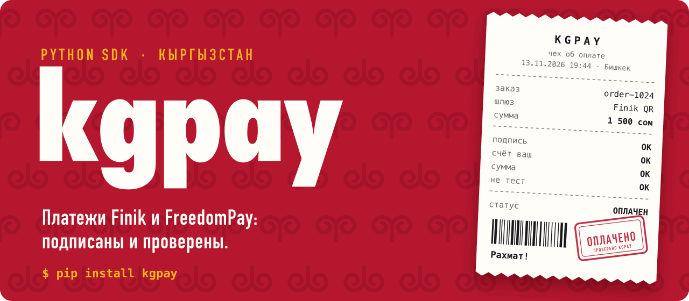
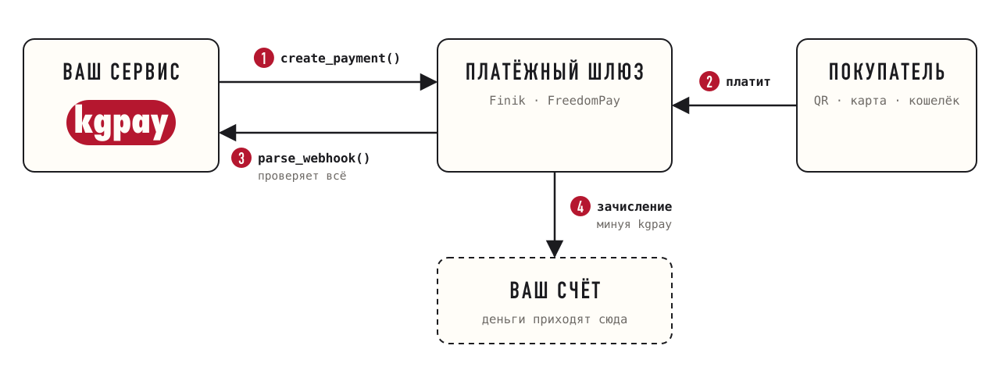

<p align="center">
  
</p>

<p align="center">
  <a href="https://pypi.org/project/kgpay/"></a>
  <a href="https://pypi.org/project/kgpay/"></a>
  <a href="https://github.com/Akjol06/kgpay/actions/workflows/tests.yml"></a>
  <a href="https://github.com/Akjol06/kgpay/blob/main/LICENSE"></a>
</p>

<p align="center">
  <a href="https://github.com/Akjol06/kgpay/blob/main/README.md">English</a> &nbsp;·&nbsp; <b>Русский</b>
</p>

<br>

Приём платежей в Кыргызстане на Python. `kgpay` подписывает каждый запрос так, как ждёт платёжный шлюз, проверяет каждый вебхук и не пропускает платежи, которые только *выглядят* оплаченными.

```bash
pip install kgpay
```

```python
from kgpay import Finik

finik = Finik(api_key=..., account_id=..., private_key=..., sandbox=True)

payment = finik.create_payment(
    amount=1500,
    payment_id="order-1024",
    description="Заказ №1024",
    redirect_url="https://shop.kg/thanks",
    webhook_url="https://shop.kg/api/webhooks/finik",
)
# → отправьте покупателя на payment.url
```

## Куда идут деньги

<p align="center">
  <picture>
    <source media="(prefers-color-scheme: dark)" srcset="https://raw.githubusercontent.com/Akjol06/kgpay/main/.github/assets/flow-ru-dark.svg">
    
  </picture>
</p>

`kgpay` — только код. Внутри нет аккаунтов, денег и общих ключей. Вы заключаете договор со шлюзом, храните свои ключи в `.env`, а деньги покупателя зачисляются прямо на ваш счёт мерчанта.

## Шлюзы

| | Шлюз | Способы оплаты | Клиенты | |
|:-:|---|---|---|---|
| 🟥 | **[Finik](https://www.finik.kg)** | QR, банковские карты | `Finik` · `AsyncFinik` | **готово** |
| 🟨 | **[FreedomPay](https://freedompay.kg)** | Карты, кошельки, QR | `FreedomPay` · `AsyncFreedomPay` | **готово** |
| ⬜ | Mbank · Бакай Банк · Оптима Банк · Элдик Банк · O!Деньги | | | [нужна помощь](#участие) |

У каждого клиента два одинаковых метода: `create_payment()` и `parse_webhook()`. Синхронные клиенты подходят для Django, Flask и скриптов, асинхронные — для FastAPI.

## Finik

```python
import os
from kgpay import AsyncFinik, ForeignAccountError, InvalidSignatureError

finik = AsyncFinik(
    api_key=os.environ["FINIK_API_KEY"],
    account_id=os.environ["FINIK_ACCOUNT_ID"],
    private_key=os.environ["FINIK_PRIVATE_KEY"],  # PEM; можно одной строкой с \n
    sandbox=True,                                 # тестовая среда, без реальных денег
    merchant_name="My Shop",                      # название на странице оплаты
)
```

**Вебхук.** Передайте сырое тело, заголовки и *публичный* путь, который вызвал Finik:

```python
@app.post("/api/webhooks/finik")
async def finik_webhook(request: Request):
    try:
        event = finik.parse_webhook(
            body=await request.body(),
            headers=request.headers,
            path="/api/webhooks/finik",
        )
    except InvalidSignatureError:
        raise HTTPException(401)
    except ForeignAccountError:
        return {"ok": True}  # подписано Finik, но деньги ушли не вам

    order = await get_order(event.payment_id)
    if event.succeeded and order and not order.paid and event.amount_covers(order.total):
        await mark_paid(order)  # идемпотентно: Finik повторяет вебхуки
    return {"ok": True}
```

Полный пример магазина на FastAPI: [`examples/fastapi_app.py`](https://github.com/Akjol06/kgpay/blob/main/examples/fastapi_app.py).

## FreedomPay

```python
from kgpay import FreedomPay

fp = FreedomPay(
    merchant_id=os.environ["FREEDOMPAY_MERCHANT_ID"],
    secret_key=os.environ["FREEDOMPAY_SECRET_KEY"],
    testing=True,
)

payment = fp.create_payment(
    amount="1500.50",                     # до 2 знаков после запятой
    payment_id="order-1024",
    description="Заказ №1024",
    redirect_url="https://shop.kg/thanks",
    failure_url="https://shop.kg/failed",  # необязательно
    webhook_url="https://shop.kg/api/webhooks/freedompay",
)
```

**Вебхук.** FreedomPay ждёт подписанный XML-ответ, и `kgpay` собирает его сам:

```python
PATH = "/api/webhooks/freedompay"

@app.post(PATH)
async def freedompay_webhook(request: Request):
    try:
        event = fp.parse_webhook(body=await request.body(), path=PATH)
    except InvalidSignatureError:
        raise HTTPException(401)

    if event.succeeded and event.amount_covers(order_total(event.payment_id)):
        await mark_paid(event.payment_id)

    return Response(fp.webhook_response(path=PATH, status="ok"), media_type="application/xml")
```

## Что kgpay проверяет за вас

Каждая строка на чеке в баннере — настоящая проверка, которую делает `parse_webhook()`, прежде чем назвать платёж успешным.

| Проверка | Зачем |
|---|---|
| **Подпись** | Finik подписывает RSA-SHA256 по каноничной строке, FreedomPay — MD5 по схеме PayBox. Обе подписи сверены байт в байт с эталонными данными самих шлюзов, включая настоящий боевой вебхук из документации Finik. |
| **Счёт ваш** | Finik подписывает вебхуки *всех* мерчантов одним ключом. Валидная подпись доказывает, что вебхук от Finik, но не что деньги ваши. Чужой счёт — `ForeignAccountError`. |
| **Сумма** | `event.amount_covers(total)` — проверка недоплаты в одну строку. Вебхук без суммы ничего не покрывает. |
| **Не тест** | Боевой клиент FreedomPay отклоняет колбэки с `pg_testing_mode=1`. |
| **Точные суммы** | Finik принимает только целые сомы. Дробь или `float` дают ошибку, а не тихое округление. |
| **Публичный путь** | Шлюз подписывает URL, который вызвал (`/api/...`), даже если nginx срезает префикс. Этот путь передаётся явно. |

Шлюзы повторяют вебхуки часами и сутками, поэтому зачисляйте заказ один раз на `payment_id`.

<details>
<summary><b>Справочник API</b></summary>

<br>

```python
payment.url                  # куда отправить покупателя
payment.payment_id           # ваш id
payment.provider_payment_id  # id у шлюза (FreedomPay)

event.status                 # PaymentStatus.SUCCEEDED | FAILED | PENDING | UNKNOWN
event.succeeded              # bool
event.payment_id             # ваш id из create_payment()
event.transaction_id         # id транзакции у шлюза
event.amount                 # Decimal | None
event.currency               # "KGS" (FreedomPay)
event.amount_covers(total)   # оплачено не меньше total?
event.raw                    # исходные данные целиком
```

| Исключение | Когда |
|---|---|
| `APIError` | Шлюз вернул ошибку или недоступен (`.status_code`, `.response_text`) |
| `InvalidSignatureError` | Подписи нет или она неверна, или тестовый платёж пришёл на боевой клиент |
| `ForeignAccountError` | Вебхук Finik о платеже на чужой `account_id` |
| `InvalidPayloadError` | Тело вебхука не разбирается |

Все наследуются от `KGPayError`.

</details>

## Участие

Самый ценный вклад — новый шлюз: **Mbank, Бакай Банк, Оптима Банк, Элдик Банк или O!Деньги**. Банки обычно выдают документацию API эквайринга только мерчантам, поэтому если она у вас есть, присылайте PR.

```bash
git clone https://github.com/Akjol06/kgpay && cd kgpay
uv sync
uv run pytest
uv run ruff check .
```

Каждый шлюз — отдельный модуль в `src/kgpay/`: синхронный и асинхронный клиент, `create_payment()` и `parse_webhook()`, плюс тесты, которые сверяют подписи с эталонными данными самого шлюза.

<br>

<p align="center">
  <sub>Лицензия MIT · независимый проект, не связан с Finik, AversPay и FreedomPay</sub>
</p>
